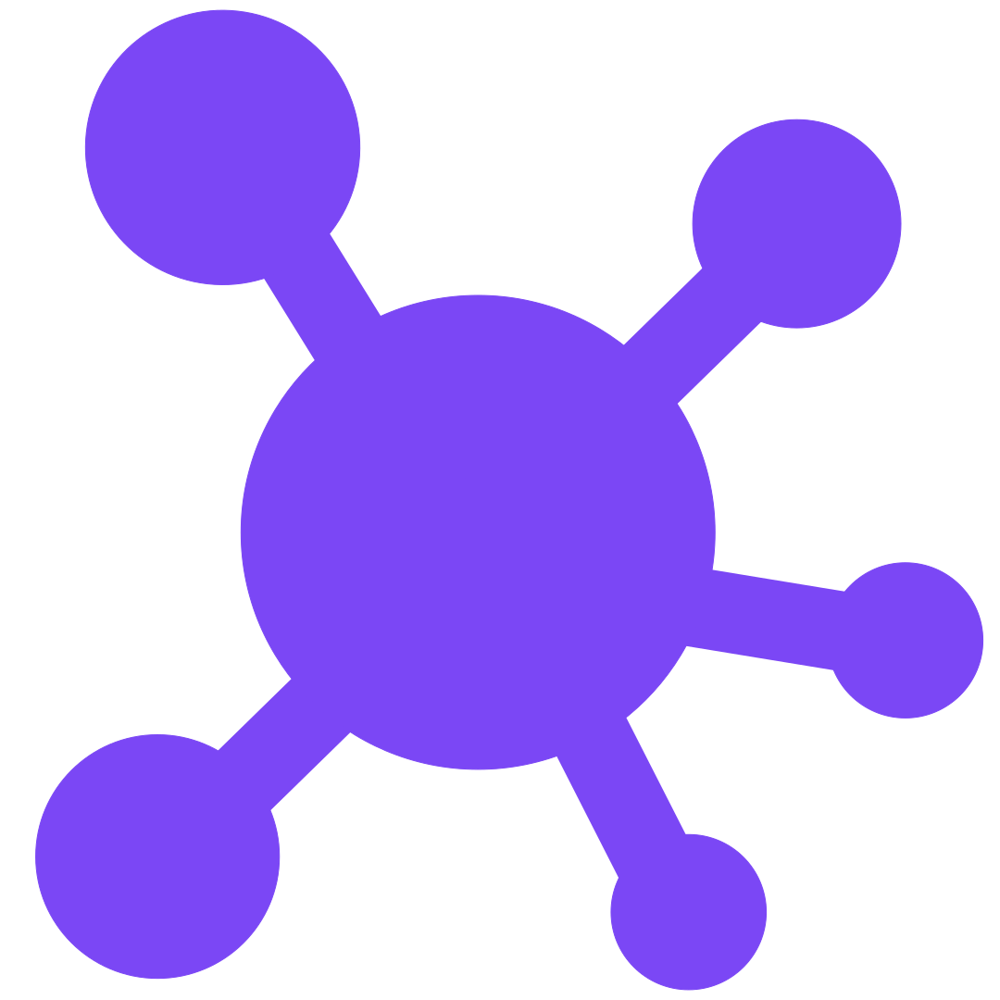
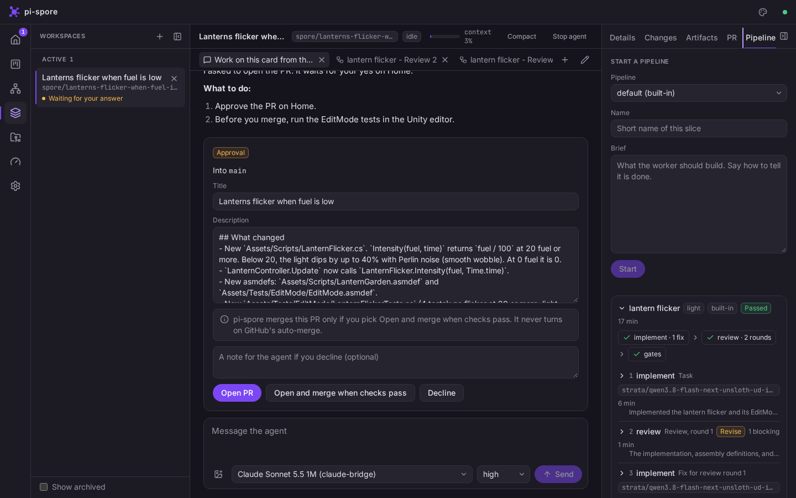
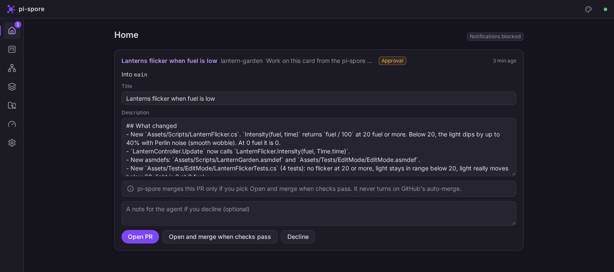
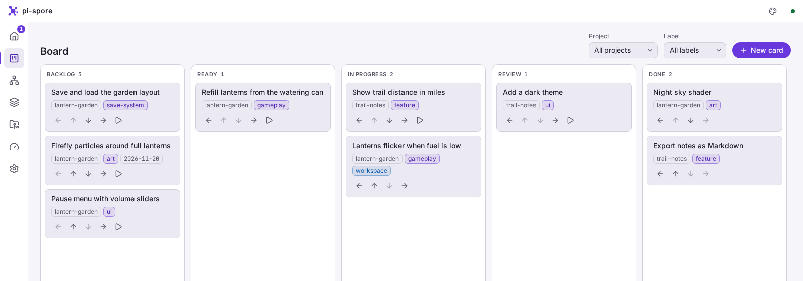
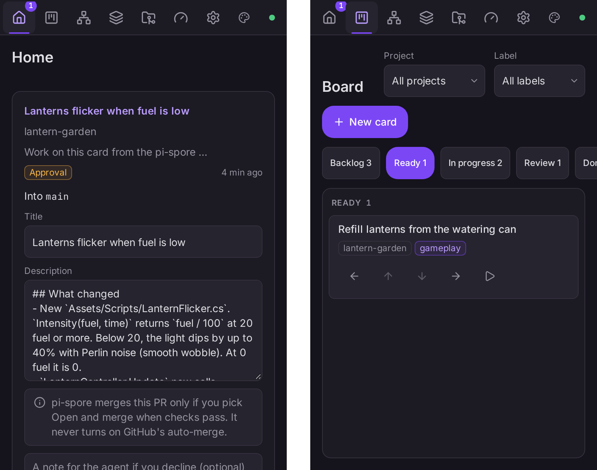

<div align="center">



# pi-spore

A local workbench for Pi coding agents.

[](LICENSE)
[](.nvmrc)

</div>

pi-spore is a local, single-user workbench. It runs [Pi](https://github.com/earendil-works/pi) coding agents across
many Git projects. It makes the worker → reviewer → adversarial reviewer flow durable, enforced, and visible. Unity
projects get first-class support.

It is a Node server, a React web UI, and a small CLI. The server binds to `127.0.0.1` only. There are no accounts and
no hosting.



## Features

- **Workspaces.** Each piece of work gets its own Git worktree and branch, with its chat, terminals, changes, and
  artifacts.
- **Chats.** Every agent is a real `pi` process with your normal Pi setup. Read-only side chats run next to the main one.
- **Pipelines.** A worker writes the code. Fresh reviewers check it, and check and test gates must pass.
- **Home and board.** Questions and approvals from agents wait on Home. A kanban board holds planned work, and a card
  starts a workspace.
- **Model router and usage.** The `spore/auto` model picks a model for each request. The Usage page shows plan
  windows and token use.
- **Unity.** pi-spore opens and closes editors, copies `Library/` into new worktrees, and runs EditMode and PlayMode
  tests as gates.
- **Phone.** The UI works on a phone and installs as a web app. It reaches the server through `tailscale serve`.

## Screenshots

All screenshots show demo data from a dev server.

| Home | Board (Spore Day theme) |
| :---: | :---: |
|  |  |

<p align="center">
  
</p>

## Quick start

You need:

- Node 26 (see `.nvmrc`)
- `git`
- [Pi](https://github.com/earendil-works/pi), set up and logged in, with `pi` on your `PATH`

```sh
nvm use
npm ci
npm run build
npm start
```

Then open <http://127.0.0.1:7420>. Set `PI_SPORE_PORT` to use another port.

The CLI talks to the same server:

```sh
node packages/cli/dist/main.js health
```

## Docs

- [Vision and requirements](docs/vision.md)
- [Architecture](docs/architecture.md)
- [Visual design](docs/design.md)
- [Decisions (ADRs)](docs/decisions/)

## License

[MIT](LICENSE)
